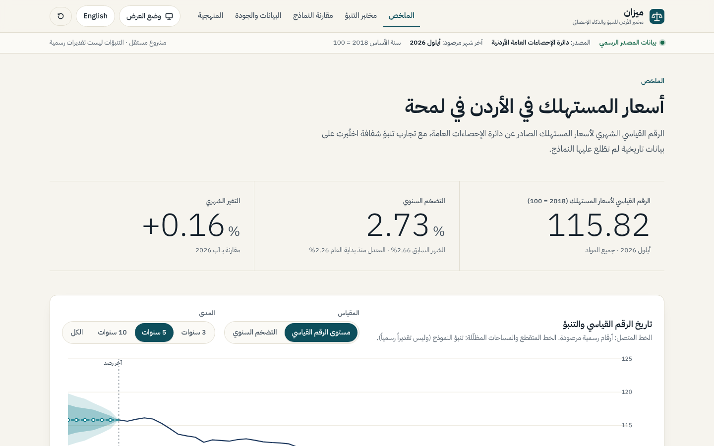
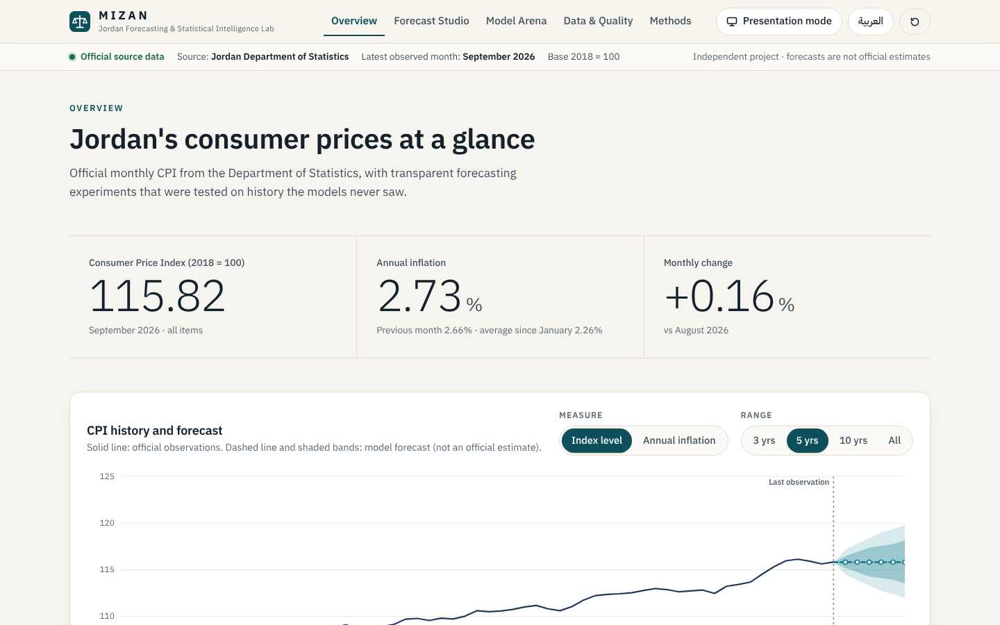
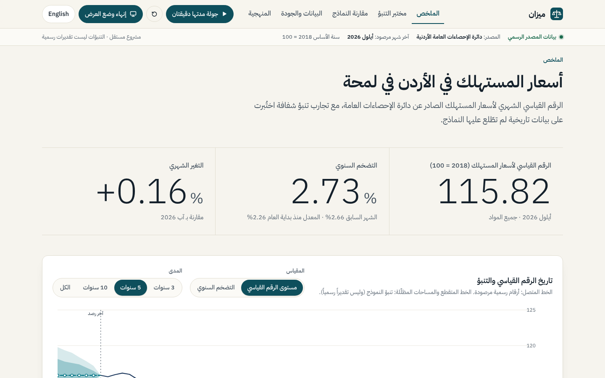
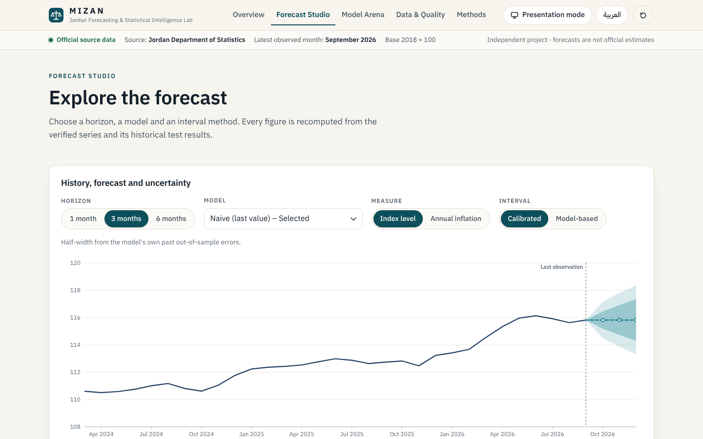
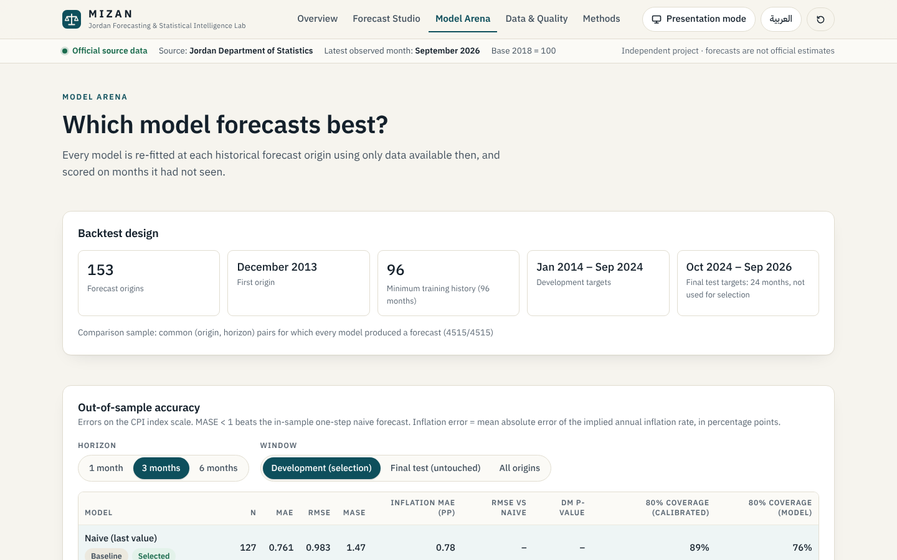

<div align="center">

# MIZAN · ميزان
### Jordan Forecasting & Statistical Intelligence Lab
**From Official Statistics to Reliable Forecasts.**

*An independent research & demonstration project – not an official product of, and not endorsed by, Jordan's Department of Statistics. Forecasts are statistical projections, not official estimates.*

</div>



MIZAN shows the full workflow from **real, traceable official data** to **transparent forecasting experiments** for Jordan's
monthly Consumer Price Index (CPI): verified source series → inflation measures → baseline and statistical models →
rolling-origin backtests on months the models never saw → clearly labelled forecasts with measured uncertainty.
It runs **fully offline** on a Windows laptop (Python only), in **Arabic (RTL)** and **English**, with a **presentation mode** and a
guided 2-minute walkthrough.

| English | Presentation mode (Arabic) |
|---|---|
|  |  |

## What is verified (real data, real results)
* **Data:** Jordan DoS *Monthly CPI (2018 = 100)*, **Jan 2006 – Sep 2026, 249 months**, no gaps, checksummed provenance.
  Latest: CPI **115.82**, annual inflation **2.73 %**, monthly **+0.16 %** – reproducing the Department's 12 Oct 2026 release.
* **Backtest:** 153 forecast origins; selection on Jan 2014 – Sep 2024; **24 untouched test months** (Oct 2024 – Sep 2026).
* **Honest finding:** no statistical model is significantly better than the naive baseline at any horizon on the development
  window (1-month: SARIMA −3.5 % RMSE, DM *p* = 0.50; 3/6-month: naive is best). On the recent test window SARIMA/drift did better, also not significantly. MIZAN shows this instead of hiding it.
* **Known caveats:** a 2018 basket link in the series; 12 months of 2018 differ from the IMF copy (documented, cause unknown). See [Known limitations](docs/KNOWN_LIMITATIONS.md).

## Live site
Public static site (auto-updated weekly from the Department of Statistics): <https://musab-abukaraki-66.github.io/Mizan/> — setup and update flow in [docs/DEPLOYMENT.md](docs/DEPLOYMENT.md).

## Run it
**Windows (recommended):** double-click **`START_MIZAN.bat`** → opens <http://127.0.0.1:8765/> (details: [SETUP_WINDOWS.md](SETUP_WINDOWS.md), checklist: [RUNNING_THE_DEMO.md](RUNNING_THE_DEMO.md)).

**Any OS:**
```bash
python launcher.py            # creates .venv, installs pinned deps, validates data, starts the app
# or manually
python -m venv .venv && .venv/bin/pip install -r requirements.txt && .venv/bin/python -m mizan serve
```
Reproduce everything: `python -m mizan ingest` (download + verify) · `python -m mizan backtest --force` (≈ 2 min).

## Views
| View | Purpose |
|---|---|
| **Overview / الملخص** | Official latest figures, history + forecast chart, 1/3/6-month forecasts, evidence summary |
| **Forecast Studio / مختبر التنبؤ** | Choose horizon, model, measure and interval method; forecast table; the model's own backtest |
| **Model Arena / مقارنة النماذج** | Out-of-sample MAE/RMSE/MASE, inflation error, Diebold–Mariano, coverage, development vs untouched test window |
| **Data & Quality / البيانات والجودة** | Coverage, validation checks, cross-checks, data dictionary, provenance & checksums |
| **Methods / المنهجية** | Definitions, models, leakage control, metrics, intervals, limits |

| Forecast Studio | Model Arena |
|---|---|
|  |  |

## Quality gates (all run in this repository)
`pytest` 95 tests · `vitest` 15 · Playwright e2e 11 (Arabic/English, RTL chart mirroring, presentation mode + reset, keyboard,
no horizontal overflow at 1440×900 and 390×844, zero console errors) · `ruff` · `tsc --strict` · `eslint` · production build.

## Docs
[Product brief](docs/PRODUCT_BRIEF.md) · [Data sources & licence](docs/DATA_SOURCES.md) · [Methodology](docs/METHODOLOGY.md) ·
[Architecture](docs/ARCHITECTURE.md) · [شرح المقابلة (عربي)](docs/INTERVIEW_WALKTHROUGH_AR.md) · [Known limitations](docs/KNOWN_LIMITATIONS.md)

## Attribution & licence
Source data: **Jordan Department of Statistics**, *Monthly Consumer Price Index (2018 = 100)*, <https://dosweb.dos.gov.jo/economic/price-indices/table-price-indices/>.
DoS reserves its rights and grants no open licence; this repository bundles only the extracted headline index values with
attribution for non-commercial research/demonstration (see [DATA_SOURCES.md](docs/DATA_SOURCES.md)). Code: [MIT](LICENSE).
Font: IBM Plex Sans Arabic (SIL OFL 1.1). Cross-check: IMF *Consumer Price Index* dataset (comparison only).
