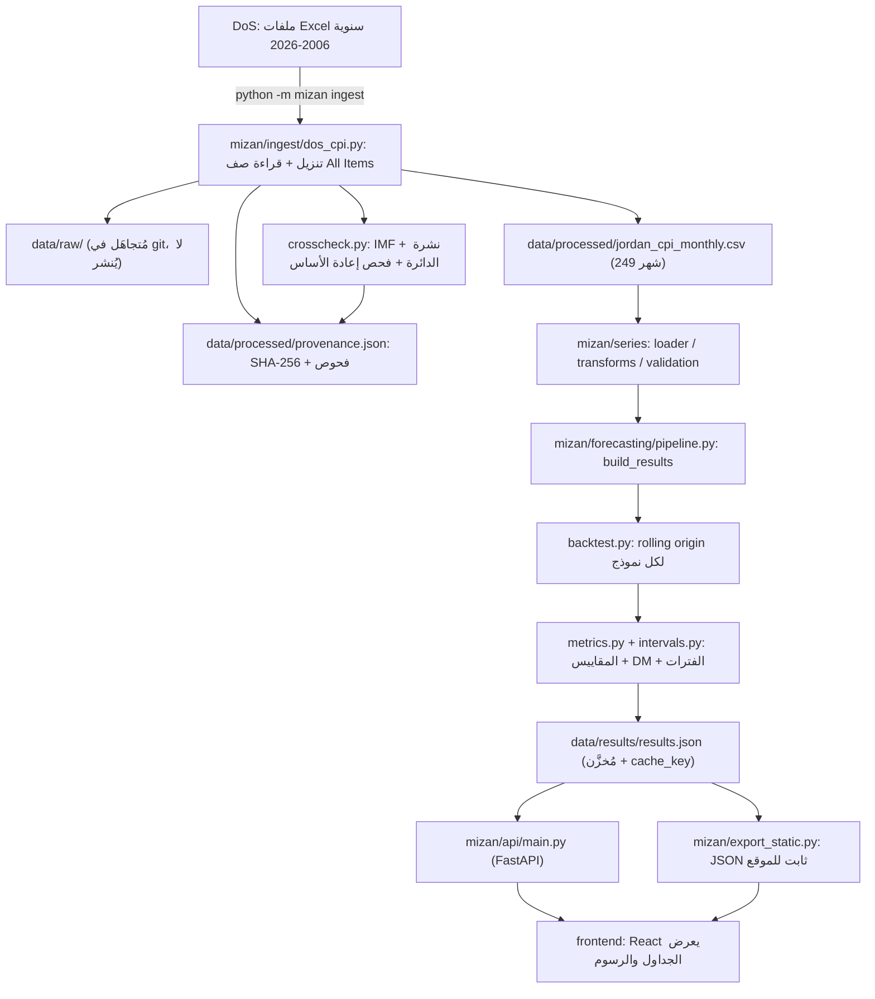

<h1 dir="rtl" align="right">ميزان (MIZAN) — الشرح الكامل بالعربي</h1>

<p dir="rtl" align="right">
هذا الملف مكتوب لصاحب المشروع ليفهم <b>كل شي</b> عن «ميزان»: شو بيعمل، من وين بتجي البيانات، كيف بتشتغل النماذج، كيف تقرأ كل رسم، وكيف تشرحه بالمقابلة بدون ما تبالغ بأي ادعاء. كل معلومة تقنية هنا مأخوذة من ملفات المشروع الفعلية (ومكتوب بجانبها <b>"أين تُنفَّذ"</b> بالمسار واسم الدالة). الأشياء اللي ما قدرت أتحقق منها مكتوبة صراحة على أنها <b>غير متحقَّق منها</b>.
</p>

<p dir="rtl" align="right">
<b>حالة المشروع وقت كتابة هذا الملف:</b> الفرع <code dir="ltr">claude/quirky-planck-g0np6x</code> (هو الفرع الافتراضي للمستودع)، والموقع المنشور: <a href="https://musab-abukaraki-66.github.io/Mizan/" dir="ltr">https://musab-abukaraki-66.github.io/Mizan/</a>
</p>

<h2 dir="rtl" align="right">فهرس المحتويات</h2>
<ol dir="rtl" style="text-align:right">
<li><a href="#a">A. ميزان في دقيقة</a></li>
<li><a href="#b">B. شو يشوف المستخدم في التطبيق</a></li>
<li><a href="#c">C. كيف انبنى المشروع — من المصدر للشاشة</a></li>
<li><a href="#d">D. البيانات — شو معناها وما مدى الثقة فيها</a></li>
<li><a href="#e">E. التنبؤ بالسلاسل الزمنية من الصفر</a></li>
<li><a href="#f">F. كيف تقرأ كل رسم ونتيجة</a></li>
<li><a href="#g">G. تشغيل المشروع على لابتوب Windows</a></li>
<li><a href="#h">H. كيف تشرح المشروع بالمقابلة</a></li>
<li><a href="#i">I. قاموس المصطلحات</a></li>
<li><a href="#j">J. الحدود والتحسينات القادمة</a></li>
<li><a href="#k">K. سيناريو العرض العملي (دقيقتان)</a></li>
</ol>

---

<h2 dir="rtl" align="right" id="a">A. ميزان في دقيقة</h2>

<h3 dir="rtl" align="right">تشبيه بسيط</h3>
<p dir="rtl" align="right">
تخيّل إنك بتتوقع حرارة بكرة. أبسط توقع: «بكرة زي اليوم». هاد اسمه <b>النموذج الساذج (Naive)</b>. ممكن حدا يجي ويقول «أنا عندي معادلة معقدة بتتنبأ أحسن». كيف بتعرف إنه صادق؟ بتخليه يتنبأ بأيام <b>قديمة</b> وهو ما شاف نتيجتها، وبتقارنه بالتوقع الساذج. «ميزان» بيعمل بالضبط هاد الشي لأسعار المستهلك في الأردن: بياخد الأرقام الرسمية، وبيجرّب عدة نماذج تنبؤ على الماضي بشكل عادل، وبيعرض لك بصراحة مين فعلاً أحسن (وأحياناً الجواب: ما حدا أحسن من الساذج).
</p>

<h3 dir="rtl" align="right">المشكلة الإحصائية</h3>
<p dir="rtl" align="right">
المشكلة: «كيف ممكن يتحرك الرقم القياسي لأسعار المستهلك (CPI) في الأشهر 1 و3 و6 القادمة، وبأي درجة من عدم اليقين، وهل فعلاً نموذجنا بيتفوق على التوقع البسيط؟». الهدف الأساسي مش «التنبؤ الأدق في العالم»، بل <b>إظهار سلسلة عمل كاملة وصادقة</b>: بيانات رسمية ← فحص جودة ← نماذج ← اختبار على بيانات لم يرها النموذج ← تنبؤ مع فترة عدم يقين.
</p>

<h3 dir="rtl" align="right">من يستخدمه؟</h3>
<ul dir="rtl" style="text-align:right">
<li>إحصائيون ومحللون يريدون رؤية workflow قابل للتكرار والتدقيق.</li>
<li>لجنة مقابلة تريد فهم المشروع بسرعة (فيه وضع عرض وجولة دقيقتين).</li>
</ul>

<h3 dir="rtl" align="right">شو بيقدر وما بيقدر يستنتج</h3>
<table dir="rtl" style="text-align:right">
<tr><th align="right">يقدر يقول</th><th align="right">ما بيقدر يقول</th></tr>
<tr><td align="right">آخر قيمة رسمية للرقم القياسي ومعدلات التضخم المحسوبة منها</td><td align="right">أي شي عن «الأسباب» (لا يوجد تحليل سببي)</td></tr>
<tr><td align="right">أي النماذج أخطأ أقل على الماضي (خارج العيّنة)</td><td align="right">إن النموذج الأفضل في الماضي سيبقى الأفضل مستقبلاً</td></tr>
<tr><td align="right">نطاق تقريبي لعدم اليقين (فترتا 80% و95%)</td><td align="right">ضمانات؛ الفترات وصف لأخطاء سابقة وليست وعداً</td></tr>
<tr><td align="right">النموذج يعتمد على سلسلة واحدة فقط (CPI)</td><td align="right">أثر قرارات حكومية أو أسعار الوقود أو سعر الصرف</td></tr>
</table>

<h3 dir="rtl" align="right">ليش هو مشروع مستقل وليس رسمياً؟</h3>
<p dir="rtl" align="right">
المستودع ما فيه أي دليل على تكليف أو اعتماد من دائرة الإحصاءات العامة. على العكس، النص مكتوب صراحة بأنه «مشروع مستقل، ليس منتجاً رسمياً، والتنبؤات ليست تقديرات رسمية»: في <code dir="ltr">README.md</code> وفي شريط المصدر أعلى كل صفحة (المفتاح <code dir="ltr">prov.note</code> في <code dir="ltr">frontend/src/i18n/ar.ts</code>) وفي تذييل الصفحة (<code dir="ltr">footer.right</code>). <b>لا تقل في المقابلة أبداً</b> إنه نظام رسمي أو معتمد.
</p>

---

<h2 dir="rtl" align="right" id="b">B. شو يشوف المستخدم في التطبيق</h2>

<p dir="rtl" align="right">
التطبيق (React + TypeScript) فيه <b>5 شاشات</b> فعلية، وكلها بالمجلد <code dir="ltr">frontend/src/views/</code>. التنقل بينها بالتبويبات أعلى الصفحة، والمسارات من نوع <code dir="ltr">#/overview</code> (الملف <code dir="ltr">frontend/src/context.tsx</code>، الدالة <code dir="ltr">parseRoute</code>).
</p>

<h3 dir="rtl" align="right">الشريط الدائم تحت العنوان (على كل الشاشات)</h3>
<p dir="rtl" align="right">
اسمه <code dir="ltr">ProvenanceStrip</code> (في <code dir="ltr">frontend/src/components/Shell.tsx</code>). بيعرض: نقطة خضراء + «بيانات المصدر الرسمي»، والمصدر (دائرة الإحصاءات العامة)، وآخر شهر مرصود، وسنة الأساس. لو فشل التحقق من البيانات بيصير بدل «بيانات المصدر الرسمي»: «لم يتم التحقق من مصدر البيانات» بلون تحذير. هاد الشريط ظاهر حتى بوضع العرض (مقصود: الإسناد ما بينخفي).
</p>

<h3 dir="rtl" align="right">1) الملخص (Overview) — <code dir="ltr">Overview.tsx</code></h3>
<ul dir="rtl" style="text-align:right">
<li><b>ثلاث أرقام كبيرة:</b> الرقم القياسي (115.82)، التضخم السنوي (2.73%)، التغير الشهري (+0.16%). كلها محسوبة من السلسلة وما فيها أرقام مكتوبة يدوياً.</li>
<li><b>رسم «تاريخ الرقم القياسي والتنبؤ»:</b> خط متصل = بيانات رسمية، خط متقطع + مساحات مظلّلة = تنبؤ (بأفق 6 أشهر). تقدر تبدّل المقياس (مستوى الرقم القياسي / التضخم السنوي) والمدى (3 سنوات، 5، 10، الكل).</li>
<li><b>ثلاث بطاقات تنبؤ:</b> للشهر القادم، بعد 3 أشهر، بعد 6 أشهر. كل بطاقة فيها القيمة، والتضخم الضمني، وفترة 80%، واسم النموذج المختار، وشارة تقول إذا النموذج الإحصائي تفوق على الساذج بفترة التطوير، وسطر عن أفضل نموذج بفترة الاختبار النهائية.</li>
<li><b>جدول «ما مدى موثوقية هذه التنبؤات؟»:</b> أخطاء RMSE للنموذج المختار مقابل الساذج، بفترتي التطوير والاختبار، مع جملة محسوبة آلياً (<code dir="ltr">anySignificantWin</code>) تقول إذا في أي نموذج إحصائي أحسن من الساذج بدلالة إحصائية.</li>
<li><b>صندوق «اقرأ التنبؤات بحذر».</b></li>
</ul>
<p dir="rtl" align="right"><b>السؤال اللي بتجاوب عليه:</b> «وين وقفت الأسعار، وشو التوقع، ومدى الثقة فيه؟». <b>تحذير تفسير:</b> البطاقة المختارة للأفقين 3 و6 هي نموذج ساذج (خط مستوٍ)، فلا تقرأ «2.29%» كأنها توقع ذكي؛ هي نتيجة قاعدة اختيار صادقة.</p>

<h3 dir="rtl" align="right">2) مختبر التنبؤ (Forecast Studio) — <code dir="ltr">Studio.tsx</code></h3>
<ul dir="rtl" style="text-align:right">
<li><b>أدوات التحكم:</b> الأفق (شهر / 3 / 6)، النموذج (قائمة فيها الخمسة، والمختار معلَّم)، المقياس (مستوى / تضخم سنوي)، نوع الفترة (<b>معايَرة</b> أو <b>مبنية على النموذج</b>).</li>
<li><b>الرسم:</b> آخر 30 شهراً + التنبؤ + نطاقي 80% و95%.</li>
<li><b>جدول «قيم التنبؤ»:</b> لكل شهر: القيمة، فترة 80%، فترة 95%، التضخم السنوي الضمني.</li>
<li><b>«عن هذا النموذج»:</b> وصف، وصيغته المقدَّرة (مثلاً <code dir="ltr">ARIMA(1,1,0) + drift</code>)، وهل هو المختار.</li>
<li><b>«الأداء التاريخي»:</b> جدول لفترات التطوير/الاختبار/الكل (MAE, RMSE, MASE, خطأ التضخم، والفرق عن الساذج) + رسم «التنبؤ مقابل الفعلي» في فترة الاختبار.</li>
</ul>
<p dir="rtl" align="right"><b>السؤال:</b> «لو اخترت نموذجاً معيناً وأفقاً معيناً، شو يطلع وكم كان أداؤه تاريخياً؟». <b>لا تستنتج:</b> إن تغيير النموذج «يغيّر الواقع»؛ هو فقط يغيّر الإسقاط الإحصائي.</p>

<h3 dir="rtl" align="right">3) مقارنة النماذج (Model Arena) — <code dir="ltr">Arena.tsx</code></h3>
<ul dir="rtl" style="text-align:right">
<li><b>«تصميم الاختبار الرجعي»:</b> 153 نقطة انطلاق، أولها كانون الأول 2013، حد أدنى 96 شهراً تدريب، أهداف التطوير (كانون الثاني 2014 – أيلول 2024)، أهداف الاختبار النهائي (تشرين الأول 2024 – أيلول 2026، 24 شهراً).</li>
<li><b>جدول «الدقة خارج العيّنة»:</b> لكل نموذج: n، MAE، RMSE، MASE، خطأ التضخم بالنقاط المئوية، الفرق في RMSE عن الساذج، قيمة p لاختبار DM، وتغطية فترة 80% (معايَرة / مبنية على النموذج). تبدّل الأفق والفترة (تطوير / اختبار / الكل).</li>
<li><b>«الدقة نسبةً إلى الساذج»:</b> أعمدة (السالب = أدق من الساذج).</li>
<li><b>«ماذا تقول الأدلة»:</b> فقرات تُبنى آلياً من النتائج.</li>
<li><b>رسم «التنبؤ مقابل الفعلي»</b> لأي نموذج، و«تفاصيل تقنية» (إخفاقات التقدير، الصيغ المختارة) تختفي بوضع العرض.</li>
</ul>
<p dir="rtl" align="right"><b>السؤال:</b> «مين أدق وبأي ثقة؟». <b>تحذير:</b> علامة «المختار» تعتمد على فترة التطوير فقط؛ علامة «الأفضل في الاختبار» معلومة تقريرية ولا تغيّر الاختيار.</p>

<h3 dir="rtl" align="right">4) البيانات والجودة (Data &amp; Quality) — <code dir="ltr">Quality.tsx</code></h3>
<ul dir="rtl" style="text-align:right">
<li>بلاطات: التغطية، عدد المشاهدات (249)، أشهر مفقودة، أشهر مكررة، سنة الأساس، ملخص الفحوص.</li>
<li>«المصدر والتعريف» و«فحوص التحقق» (13 فحصاً على السلسلة المحمَّلة: 12 ناجحاً وتحذير واحد هو «تغير شهري يتجاوز 5%») و«فحوص أُجريت عند الاستيراد» (عمود «المعدل»، المقارنة مع IMF، مطابقة نشرة الدائرة).</li>
<li>جدول «يُعيد إنتاج آخر نشرة رسمية»، وصندوق مقارنة IMF، وصندوق «انقطاع معروف: سلة جديدة في كانون الثاني 2018»، وقاموس البيانات، وصندوق «الإسناد وإعادة الاستخدام».</li>
<li>لوحة «تفاصيل المصدر (تقنية)» فيها بصمات SHA-256 — تختفي بوضع العرض.</li>
</ul>
<p dir="rtl" align="right"><b>السؤال:</b> «هل أثق بالأرقام ولماذا؟».</p>

<h3 dir="rtl" align="right">5) المنهجية (Methods) — <code dir="ltr">Methods.tsx</code></h3>
<p dir="rtl" align="right">شرح ثابت (مع أرقام تُقرأ من النتائج): الرقم القياسي مقابل التضخم، النماذج، الاختبار الرجعي وضبط التسرّب (مع شريط زمني)، المقاييس، فترات التنبؤ، حدود التفسير، الفرق بين التنبؤ والإحصاءات الرسمية.</p>

<h3 dir="rtl" align="right">ميزات عامة</h3>
<table dir="rtl" style="text-align:right">
<tr><th align="right">الميزة</th><th align="right">كيف تشتغل (مؤكَّد من الكود)</th></tr>
<tr><td align="right">العربية/الإنجليزية</td><td align="right">زر اللغة. الافتراضي <b>العربية</b>، ويمكن فرض الإنجليزية بـ <code dir="ltr">?lang=en</code>. اللغة تُحفظ بـ localStorage. الملف: <code dir="ltr">frontend/src/context.tsx</code> (<code dir="ltr">initialLang</code>)، والنصوص <code dir="ltr">frontend/src/i18n/{en,ar}.ts</code>.</td></tr>
<tr><td align="right">RTL حقيقي</td><td align="right">يُضبط <code dir="ltr">dir="rtl"</code> على الصفحة، وCSS بخصائص منطقية، والرسوم تنعكس: <b>الزمن يسير من اليمين لليسار</b> ومحور القيم على اليمين (<code dir="ltr">frontend/src/components/Chart.tsx</code>، المعامل <code dir="ltr">rtl</code>).</td></tr>
<tr><td align="right">وضع العرض</td><td align="right">يخفي عناصر <code dir="ltr">.dev-only</code> (بصمات، إخفاقات التقدير…) ويكبّر الرسم والأرقام ويرجع للملخص. شريط المصدر وتنبيهات الحذر تبقى ظاهرة.</td></tr>
<tr><td align="right">الجولة (دقيقتان)</td><td align="right">5 خطوات: المصدر، الأرقام، الرسم، الاختبار، الحدود (<code dir="ltr">frontend/src/components/Walkthrough.tsx</code>). بتضيء كل قسم بالتتابع.</td></tr>
<tr><td align="right">إعادة الضبط</td><td align="right">زر «إعادة الضبط» يرجع: العربية، إنهاء وضع العرض، الجولة، خيارات المختبر والمقارنة، وصفحة الملخص (<code dir="ltr">resetDemo</code>).</td></tr>
<tr><td align="right">لوحة المفاتيح</td><td align="right">على أي رسم: ← → للتنقل بين الأشهر، Home/End، Esc لإخفاء التلميح.</td></tr>
</table>

---

<h2 dir="rtl" align="right" id="c">C. كيف انبنى المشروع — من المصدر للشاشة</h2>



<p dir="rtl" align="right">الشرح خطوة خطوة (كل خطوة موجودة فعلاً بالكود):</p>
<ol dir="rtl" style="text-align:right">
<li><b>الحصول على البيانات:</b> <code dir="ltr">mizan/ingest/dos_cpi.py</code> ← <code dir="ltr">download_year</code> ينزّل ملف Excel لكل سنة من موقع الدائرة (مع إعادة المحاولة 5 مرات لأن الخادم أحياناً بيقطع الاتصال)، و<code dir="ltr">parse_workbook</code> يلاقي صف «All Items» بالاعتماد على <b>نص عناوين الأشهر</b> (وليس رقم العمود).</li>
<li><b>الملفات الخام والبصمات:</b> الملفات الأصلية تنحفظ في <code dir="ltr">data/raw/</code> لكنها <b>مُتجاهَلة بـ git</b> (<code dir="ltr">.gitignore</code>) ولا تُنشر. بدلها يُسجَّل <b>SHA-256</b> وحجم كل ملف في <code dir="ltr">data/processed/provenance.json</code>.</li>
<li><b>التحقق:</b> <code dir="ltr">mizan/series/validation.py</code> ← <code dir="ltr">validate_series</code> (ترتيب، تكرار، أشهر مفقودة، قيم رقمية وموجبة، نطاق معقول، تغير شهري كبير، متوسط 2018 = 100، تطابق مع سجل المصدر). لا يوجد <b>أي ملء أو استكمال</b> للقيم.</li>
<li><b>الحسابات:</b> <code dir="ltr">mizan/series/transforms.py</code> (<code dir="ltr">mom_change</code>, <code dir="ltr">yoy_change</code>, <code dir="ltr">average_inflation</code>).</li>
<li><b>خط التنبؤ:</b> <code dir="ltr">mizan/forecasting/pipeline.py</code> ← <code dir="ltr">build_results</code>: يتحقق من البيانات أولاً (يرفض التشغيل لو فشل فحص)، يشغّل النماذج الخمسة بالتوازي (<code dir="ltr">run_backtests</code>)، يحسب المقاييس (<code dir="ltr">accuracy_tables</code>)، يختار النموذج لكل أفق (<code dir="ltr">pick_champions</code>)، ويتنبأ للمستقبل (<code dir="ltr">final_forecasts</code>).</li>
<li><b>الاختبار الرجعي والفترات:</b> <code dir="ltr">backtest.py</code> و<code dir="ltr">intervals.py</code> و<code dir="ltr">metrics.py</code> (تفاصيل بالقسم E).</li>
<li><b>التخزين:</b> النتائج تنحفظ كملف JSON واحد <code dir="ltr">data/results/results.json</code> (مُرسَل للمستودع عمداً لتفتح الواجهة فوراً). فيه <code dir="ltr">cache_key</code> = بصمة (بيانات + إعدادات التجربة + ملفات التنبؤ)، فإذا تغيّر أي منها <code dir="ltr">results_are_fresh()</code> ترجع <code dir="ltr">False</code> ويُعاد البناء.</li>
<li><b>الخدمة والواجهة:</b> <code dir="ltr">mizan/api/main.py</code> (FastAPI) يقرأ الملف ويقدّم نقاط مثل <code dir="ltr">/api/overview</code> و<code dir="ltr">/api/forecast</code> و<code dir="ltr">/api/arena</code> و<code dir="ltr">/api/quality</code>. الواجهة (مبنية مسبقاً في <code dir="ltr">mizan/web</code>) تعرضها. وللموقع العام: <code dir="ltr">python -m mizan export-static</code> يكتب كل الاستجابات كملفات JSON ثابتة في <code dir="ltr">site/api/</code>.</li>
</ol>
<p dir="rtl" align="right"><b>ما هو «مستقبلي» (غير موجود):</b> نماذج متعددة المتغيرات، تفصيل مجموعات الإنفاق (COICOP)، سيناريوهات. هذه ليست منفَّذة.</p>

---

<h2 dir="rtl" align="right" id="d">D. البيانات — شو معناها وما مدى الثقة فيها</h2>

<h3 dir="rtl" align="right">شو يقيس الرقم القياسي لأسعار المستهلك (CPI)؟</h3>
<p dir="rtl" align="right">
تخيّل «سلة مشتريات» ثابتة (حسب تعريف السلسلة المسجَّل في <code dir="ltr">provenance.json</code> نحو 850 صنفاً) تمثل ما تشتريه الأسر. الرقم القياسي بيقيس كم بتكلّف هذه السلة هالشهر مقارنة بسنة الأساس. هو <b>ليس «تكلفة المعيشة»</b> بالمطلق، لأنه يعكس سلة محددة وأوزاناً محددة.
</p>

<h3 dir="rtl" align="right">الحقائق المؤكَّدة من المستودع</h3>
<table dir="rtl" style="text-align:right">
<tr><th align="right">البند</th><th align="right">القيمة</th><th align="right">أين تتحقق</th></tr>
<tr><td align="right">المصدر</td><td align="right">دائرة الإحصاءات العامة، «Monthly Consumer Price Index (2018=100)»</td><td align="right"><code dir="ltr">data/processed/provenance.json</code></td></tr>
<tr><td align="right">سنة الأساس</td><td align="right">2018 = 100 (متوسط 2018 = 100 بالضبط)</td><td align="right">فحص <code dir="ltr">base_year</code></td></tr>
<tr><td align="right">التكرار</td><td align="right">شهري</td><td align="right"><code dir="ltr">series.frequency</code></td></tr>
<tr><td align="right">المدى</td><td align="right">كانون الثاني 2006 → أيلول 2026</td><td align="right"><code dir="ltr">data/processed/jordan_cpi_monthly.csv</code></td></tr>
<tr><td align="right">عدد المشاهدات</td><td align="right">249 شهراً، بلا فجوات (0 مفقود، 0 مكرر)</td><td align="right">فحصا <code dir="ltr">complete</code> و<code dir="ltr">unique</code></td></tr>
<tr><td align="right">آخر شهر</td><td align="right">أيلول 2026، قيمة <code dir="ltr">115.8156</code></td><td align="right">قُرئ من الملف وليس مفترضاً</td></tr>
<tr><td align="right">التعديل الموسمي</td><td align="right">غير مذكور من الدائرة، فنتعامل معه كغير معدَّل موسمياً</td><td align="right"><code dir="ltr">series.seasonal_adjustment</code></td></tr>
</table>

<h3 dir="rtl" align="right">ثلاثة أشياء تختلط على الناس</h3>
<ol dir="rtl" style="text-align:right">
<li><b>الرقم القياسي (CPI):</b> مستوى السعر النسبي (مثلاً 115.82).</li>
<li><b>التغير الشهري (MoM):</b> كم تغيّر عن الشهر السابق.</li>
<li><b>التضخم السنوي (YoY):</b> كم تغيّر عن نفس الشهر قبل سنة. هذا الرقم اللي بتسمعه بالأخبار.</li>
</ol>

<p dir="rtl" align="right">الصيغ كما هي في الكود (<code dir="ltr">mizan/series/transforms.py</code>):</p>

```text
MoM  = 100 * (CPI[t] / CPI[t-1]  - 1)      # mom_change
YoY  = 100 * (CPI[t] / CPI[t-12] - 1)      # yoy_change
Average-to-date = 100 * (mean(CPI, Jan..m this year) / mean(CPI, Jan..m last year) - 1)   # average_inflation
```

<p dir="rtl" align="right"><b>مثال حقيقي محسوب من بيانات المشروع</b> (وليس افتراضياً): أيلول 2026 = <code dir="ltr">115.8156</code>، أيلول 2025 = <code dir="ltr">112.7386</code>، آب 2026 = <code dir="ltr">115.6259</code>. إذن YoY = 100×(115.8156/112.7386 − 1) ≈ <b>2.73%</b> وMoM = 100×(115.8156/115.6259 − 1) ≈ <b>+0.16%</b>. وهي مطابقة للأرقام المعلنة في نشرة الدائرة بتاريخ 12 تشرين الأول 2026 (2.73% و0.16% و2.26% لمتوسط الأشهر التسعة) — الاختبار <code dir="ltr">tests/test_bundled_data.py::test_press_release_figures_reproduced</code> يتأكد من ذلك.</p>

<h3 dir="rtl" align="right">من وين جاءت الملفات</h3>
<ul dir="rtl" style="text-align:right">
<li>صفحة الدائرة: <code dir="ltr">https://dosweb.dos.gov.jo/economic/price-indices/table-price-indices/</code> وفيها ملف لكل سنة بالشكل <code dir="ltr">.../Price_Indices/CPI/{YEAR}.xlsx</code> (الثابت <code dir="ltr">DOS_FILE_URL</code> في <code dir="ltr">mizan/config.py</code>).</li>
<li>من 2006 فصاعداً الدائرة تنشر <b>كل</b> السنوات على أساس 2018 = 100، فلا يوجد «ربط» من طرف المشروع.</li>
</ul>

<h3 dir="rtl" align="right">فحوص الجودة وحدودها</h3>
<ul dir="rtl" style="text-align:right">
<li><b>فجوات وتكرار:</b> مفحوصة ونتيجتها صفر.</li>
<li><b>تطابق مع عمود «المعدل» السنوي</b> في كل ملف من الدائرة (21 ملفاً): نجح.</li>
<li><b>المراجعات (Revisions):</b> المشروع لا يتتبع مراجعات الدائرة اللاحقة للقيم السابقة. <i>غير متحقَّق منه / غير منفَّذ.</i> الأسبوعي التلقائي يعيد التنزيل فيلتقط أي تغيير في القيم لكنه لا «يشرح» التغيير.</li>
<li><b>تغيّر السلة (2018):</b> القيم قبل 2018 هي السلسلة القديمة (2010=100) بعد ضربها بمعامل ثابت واحد (تحقق المشروع: النسبة ثابتة في ملف 2017). من كانون الثاني 2018 تُستخدم سلة جديدة، فالتغير بين كانون الأول 2017 وكانون الثاني 2018 (+1.02% بالسلسلة الجديدة، و+0.69% بالقديمة) يحتوي «قفزة ربط» لمرة واحدة. مُعلَن في صفحة «البيانات والجودة».</li>
</ul>

<h3 dir="rtl" align="right">خلاف 2018 مع صندوق النقد الدولي (IMF)</h3>
<p dir="rtl" align="right"><b>الحالة الحالية (ما زالت قائمة):</b> 235 من 247 شهراً متداخلاً تتطابق مع IMF بفارق ≤ 0.01. الـ12 شهراً المختلفة كلها في <b>2018</b>. أكبر فرق: آذار 2018 = 99.545 عند الدائرة مقابل 98.822 عند IMF. السلسلتان لهما <b>نفس المتوسط (100)</b> لعام 2018، فالفرق في توزيع الأشهر داخل السنة فقط. <b>ما نعرفه:</b> الفرق موجود ومحصور بـ2018. <b>ما لا نعرفه:</b> السبب (لم يُحدَّد). <b>القرار:</b> اعتماد ملفات الدائرة لأنها تعيد إنتاج عمودها السنوي ونشرتها الأخيرة. يظهر ذلك في «البيانات والجودة» كتحذير (ليس إخفاقاً)، ومكتوب في <code dir="ltr">docs/DATA_SOURCES.md</code>. الدالة: <code dir="ltr">imf_crosscheck</code> في <code dir="ltr">mizan/ingest/crosscheck.py</code>.</p>

<h3 dir="rtl" align="right">الترخيص وإعادة النشر</h3>
<p dir="rtl" align="right">
شروط موقع الدائرة تحفظ حقوق النشر «ما لم يُذكر خلاف ذلك» ولا تمنح ترخيصاً مفتوحاً. <b>موقف المستودع الفعلي:</b> يتضمن القيم المستخرجة للرقم القياسي العام فقط (249 رقماً) مع الإسناد، لأغراض بحثية وتوضيحية غير تجارية، ولا ينشر ملفات Excel الأصلية. <b>الإسناد لا يمنح إذناً تلقائياً بإعادة النشر</b>، والمسألة <b>غير محسومة قانونياً</b>: القرار بإبقاء الأرقام منشورة قرار صاحب المشروع، وإذا طلبت الدائرة الإزالة فعلى المستودع حذف الملف. بيانات IMF لا تُنشر إطلاقاً (للمقارنة فقط). التفاصيل: <code dir="ltr">docs/DATA_SOURCES.md</code>.
</p>

<p dir="rtl" align="right"><b>الفرق الجوهري:</b> قيمة <u>محسوبة من السلسلة</u> (مثل 2.73%) حقيقة رياضية مبنية على أرقام رسمية؛ أما <u>التنبؤ</u> فهو تقدير نموذج ويحتمل الخطأ.</p>

---

<h2 dir="rtl" align="right" id="e">E. التنبؤ بالسلاسل الزمنية من الصفر</h2>

<h3 dir="rtl" align="right">1) السلسلة الزمنية ولماذا نقيّمها بالوقت</h3>
<p dir="rtl" align="right">
السلسلة الزمنية = قيم مرتبة بالزمن (هنا: رقم لكل شهر). القيمة اليوم مرتبطة بقيمة الأمس. لو خلطنا الأشهر عشوائياً بين «تدريب» و«اختبار» (random split) بنكون «بنغش»: النموذج بيشوف المستقبل وهو بيتدرب. لذلك التقييم هنا <b>زمني دائماً</b>.
</p>

<h3 dir="rtl" align="right">2) شو الهدف المتنبَّأ به؟</h3>
<p dir="rtl" align="right">
<b>الهدف هو مستوى الرقم القياسي (CPI) نفسه</b> وليس معدل التضخم. النماذج (ETS وSARIMA) تعمل على <b>لوغاريتم</b> الرقم القياسي. بعدها يُحوَّل الناتج إلى «تضخم سنوي ضمني» = 100×(تنبؤ ÷ قيمة نفس الشهر قبل سنة − 1) (في <code dir="ltr">final_forecasts</code> وفي <code dir="ltr">backtest_model</code>، الأعمدة <code dir="ltr">yoy_actual</code>/<code dir="ltr">yoy_forecast</code>). خطأ التضخم يُحسب ويُعرض <b>منفصلاً</b> بالنقاط المئوية.
</p>

<h3 dir="rtl" align="right">3) النماذج الخمسة المنفَّذة (<code dir="ltr">mizan/forecasting/models.py</code>)</h3>
<table dir="rtl" style="text-align:right">
<tr><th align="right">المعرّف / الصنف</th><th align="right">الفكرة بالعربي</th><th align="right">ملاحظة</th></tr>
<tr><td align="right"><code dir="ltr">naive</code> — <code dir="ltr">Naive</code></td><td align="right">«كل الأشهر القادمة = آخر قيمة»</td><td align="right">المعيار الأساسي (baseline)</td></tr>
<tr><td align="right"><code dir="ltr">seasonal_naive</code> — <code dir="ltr">SeasonalNaive</code></td><td align="right">«كل شهر = نفس الشهر قبل سنة»</td><td align="right">معيار موسمي مطلوب؛ على سلسلة صاعدة يتأخر بنحو سنة تضخم، فأداؤه سيئ <b>بطبيعته</b></td></tr>
<tr><td align="right"><code dir="ltr">drift</code> — <code dir="ltr">Drift</code></td><td align="right">آخر قيمة × متوسط النمو الشهري لآخر 12 شهراً</td><td align="right">اتجاه بسيط (نافذة 12 = <code dir="ltr">drift_window</code>)</td></tr>
<tr><td align="right"><code dir="ltr">ets</code> — <code dir="ltr">ETS</code></td><td align="right">تمهيد أسي (ETS): يعطي وزناً أكبر للأحدث. يُختار شكل الاتجاه (بلا/جمعي/متناقص) والموسمية بمعيار <b>AICc</b> على بيانات التدريب فقط</td><td align="right">6 احتمالات (<code dir="ltr">ETS.GRID</code>)؛ الأكثر اختياراً <code dir="ltr">ETS(A,Ad,N)</code> في 141 من 153 نقطة</td></tr>
<tr><td align="right"><code dir="ltr">sarima</code> — <code dir="ltr">Sarima</code></td><td align="right">ARIMA موسمي بفرق واحد وحد انجراف على اللوغاريتم؛ الرتب تُختار من 12 احتمالاً بـAICc</td><td align="right">الأكثر اختياراً <code dir="ltr">ARIMA(1,1,0) + drift</code> (118 من 153). لو فشل أفضل احتمال بالتقارب يُجرَّب التالي (0 إخفاقات بالتشغيل الحالي)</td></tr>
</table>
<p dir="rtl" align="right"><b>AICc:</b> مقياس يوازن بين «جودة الملاءمة» و«تعقيد النموذج»؛ الأقل أفضل. يُحسب <u>فقط</u> على بيانات التدريب عند كل نقطة انطلاق (لا تسرّب). اختيار الصيغة يُعاد كل 6 نقاط (<code dir="ltr">reselect_every = 6</code>) بينما تُقدَّر المعاملات من جديد عند كل نقطة.</p>

<h3 dir="rtl" align="right">4) نوافذ التدريب والتطوير والاختبار (الأرقام من <code dir="ltr">results.json</code> و<code dir="ltr">mizan/config.py</code>)</h3>
<table dir="rtl" style="text-align:right">
<tr><th align="right">البند</th><th align="right">القيمة</th></tr>
<tr><td align="right">الحد الأدنى للتدريب (<code dir="ltr">min_train</code>)</td><td align="right">96 شهراً (كانون الثاني 2006 → كانون الأول 2013)</td></tr>
<tr><td align="right">أول نقطة انطلاق</td><td align="right">كانون الأول 2013؛ إجمالي النقاط <b>153</b></td></tr>
<tr><td align="right">فترة التطوير (اختيار النموذج)</td><td align="right">الأشهر المستهدفة: كانون الثاني 2014 → أيلول 2024 (129 / 127 / 124 مشاهدة للآفاق 1/3/6)</td></tr>
<tr><td align="right">فترة الاختبار النهائية (<code dir="ltr">test_months</code>)</td><td align="right">آخر 24 شهراً مستهدفاً: تشرين الأول 2024 → أيلول 2026، لا تؤثر في الاختيار أبداً</td></tr>
<tr><td align="right">الآفاق المقيَّمة</td><td align="right">1 و3 و6 أشهر (<code dir="ltr">horizons</code>)؛ الواجهة تدعم هذه الثلاثة فقط (<code dir="ltr">_horizon</code> في <code dir="ltr">api/main.py</code>)</td></tr>
</table>
<p dir="rtl" align="right"><b>ملاحظة:</b> «فترة الاختبار» هنا هي نافذة مستهدفة تقع في الجزء الأخير من التاريخ، لكن النماذج عند نقاط انطلاق لاحقة تتدرب على بيانات متاحة حتى ذلك التاريخ (هذا طبيعي بالأصل المتحرك). المهم: الاختيار استخدم أخطاء فترة التطوير فقط.</p>

<h3 dir="rtl" align="right">5) الاختبار الرجعي بأصل متحرك (Rolling-origin backtesting)</h3>
<p dir="rtl" align="right">
عند كل شهر «نقطة انطلاق» (<code dir="ltr">t</code>): نخفي كل شي بعده، ندرّب النموذج على ما قبله وبه، نتنبأ بالأشهر t+1 … t+6، ثم نقارن بما حصل فعلاً. نكرر لـ153 شهراً (<code dir="ltr">backtest_model</code> في <code dir="ltr">backtest.py</code>، والتدريب دائماً <code dir="ltr">s.iloc[: t + 1]</code>). هكذا نحصل على مئات «اختبارات تنبؤ حقيقية» بدل اختبار واحد.
</p>
<p dir="rtl" align="right"><b>كيف نضمن عدم التسرّب (Leakage)؟</b> اختبارات آلية: <code dir="ltr">tests/test_backtest.py::test_no_leakage_future_changes_do_not_alter_earlier_forecasts</code> تغيّر كل القيم بعد شهر معيّن ثلاث أضعاف وتتأكد أن كل التنبؤات عند نقاط انطلاق أقدم بقيت <b>مطابقة بالبت</b>. ونفس الفكرة لمعايرة الفترات (<code dir="ltr">tests/test_intervals.py</code>).</p>
<p dir="rtl" align="right"><b>عدالة المقارنة:</b> كل النماذج تُقيَّم على نفس أزواج (نقطة انطلاق، أفق)؛ لو فشل نموذج بنقطة تُحذف النقطة للجميع (<code dir="ltr">pipeline.build_results</code>، «common sample»). بالتشغيل الحالي لا حذف (4515 من 4515).</p>

<h3 dir="rtl" align="right">6) المقاييس (أقل = أفضل في كلها)</h3>
<table dir="rtl" style="text-align:right">
<tr><th align="right">المقياس</th><th align="right">المعنى</th><th align="right">ملاحظة</th></tr>
<tr><td align="right"><b>MAE</b> (متوسط الخطأ المطلق)</td><td align="right">متوسط الفرق بين التنبؤ والفعلي بنقاط الرقم القياسي، بدون إشارة</td><td align="right">سهل الفهم</td></tr>
<tr><td align="right"><b>RMSE</b> (جذر متوسط مربع الخطأ)</td><td align="right">نفس الفكرة لكن بيعاقب الأخطاء الكبيرة أكثر</td><td align="right"><b>هو معيار اختيار النموذج</b></td></tr>
<tr><td align="right"><b>MASE</b></td><td align="right">MAE مقسوماً على متوسط خطأ التنبؤ الساذج بخطوة واحدة داخل أول 96 شهراً (<code dir="ltr">0.516</code>)</td><td align="right">أقل من 1 = أفضل من ذلك المعيار</td></tr>
<tr><td align="right"><b>خطأ التضخم (نقطة مئوية)</b></td><td align="right">MAE لمعدل التضخم السنوي الضمني</td><td align="right">منفصل عن أخطاء الرقم القياسي</td></tr>
<tr><td align="right">MAPE</td><td align="right">نسبة مئوية للخطأ</td><td align="right">محسوب للاطلاع فقط ولا يُستخدم بالترتيب</td></tr>
<tr><td align="right">التغطية (Coverage)</td><td align="right">نسبة القيم الفعلية الواقعة داخل الفترة</td><td align="right">الاسمي: 80%</td></tr>
</table>
<p dir="rtl" align="right"><b>مثال توضيحي افتراضي (ليس من نتائج المشروع):</b> نموذج تنبأ لثلاثة أشهر بـ 100، 101، 102 والفعلي 101، 101، 104. الأخطاء المطلقة: 1، 0، 2 ⇒ MAE = 1. مربعات الأخطاء: 1، 0، 4 ⇒ المتوسط 1.67 ⇒ RMSE ≈ 1.29. لاحظ أن RMSE أكبر من MAE لأن الخطأ الأكبر (2) أخذ وزناً أكثر.</p>

<h3 dir="rtl" align="right">7) فترات التنبؤ (Prediction intervals)</h3>
<p dir="rtl" align="right"><b>الفكرة:</b> بدل رقم واحد، نعطي نطاقاً «نتوقع غالباً أن يقع فيه الفعلي». يوجد نوعان في المشروع (والافتراضي المعروض هو <b>المعايَر</b>):</p>
<ul dir="rtl" style="text-align:right">
<li><b>المبنية على النموذج (model-based):</b> من افتراضات خطأ النموذج نفسه (ETS/SARIMA)، أو من انحراف عشوائي (للنماذج البسيطة؛ <code dir="ltr">_recent_std</code> على آخر 60 شهراً، <code dir="ltr">SIGMA_WINDOW</code>).</li>
<li><b>المعايَرة (calibrated):</b> <code dir="ltr">mizan/forecasting/intervals.py</code>. نصف عرض النطاق (على مقياس اللوغاريتم) = كمّي من <b>أخطاء النموذج السابقة خارج العيّنة</b> التي كانت قد ظهرت فعلاً وقت التنبؤ: <code dir="ltr">q = quantile(|log(actual/forecast)|, min(1, ceil((n+1)·L)/n))</code> ثم النطاق = التنبؤ × e<sup>±q</sup>. يلزم 24 خطأ سابقاً على الأقل (<code dir="ltr">MIN_CALIBRATION</code>). تغطيتها تُقاس في الاختبار الرجعي نفسه دون تسرّب.</li>
</ul>
<p dir="rtl" align="right"><b>ماذا وجدنا؟</b> فترات ETS وSARIMA المبنية على النموذج «أعرض من اللازم» (تغطية 80% الاسمية تصل ≈ 95% في التطوير) لأن الانحراف المقدَّر متأثر بسنوات 2007–2008 المتقلبة. المعايَرة أقرب للاسمي بفترة التطوير (حوالي 82–99% لغير الساذج الموسمي) لكنها بفترة الاختبار الهادئة تتراوح بين 83% و100% (غالباً أعلى من اللازم). <b>الفترات ليست ضماناً.</b></p>

<h3 dir="rtl" align="right">8) كيف يُختار «النموذج الفائز»؟ (القاعدة الفعلية)</h3>
<p dir="rtl" align="right">
الدالة <code dir="ltr">pick_champions</code> في <code dir="ltr">pipeline.py</code>: <b>لكل أفق، النموذج صاحب أقل RMSE على فترة التطوير فقط</b>. فترة الاختبار النهائية تُحسب وتُعرض لكن <b>لا تدخل</b> بالاختيار. لا يوجد افتراض أن النموذج المعقد يربح.
</p>

<h3 dir="rtl" align="right">9) النتائج الفعلية (من <code dir="ltr">data/results/results.json</code>)</h3>
<table dir="rtl" style="text-align:right">
<tr><th align="right">الأفق</th><th align="right">RMSE تطوير: ساذج</th><th align="right">drift</th><th align="right">ETS</th><th align="right">SARIMA</th><th align="right">المختار</th><th align="right">RMSE اختبار: ساذج → SARIMA</th></tr>
<tr><td align="right">شهر واحد</td><td align="right">0.464</td><td align="right">0.464</td><td align="right">0.454</td><td align="right">0.447</td><td align="right"><b>SARIMA</b></td><td align="right">0.406 → 0.326</td></tr>
<tr><td align="right">3 أشهر</td><td align="right">0.983</td><td align="right">1.000</td><td align="right">1.009</td><td align="right">0.997</td><td align="right"><b>ساذج</b></td><td align="right">0.967 → 0.802</td></tr>
<tr><td align="right">6 أشهر</td><td align="right">1.575</td><td align="right">1.638</td><td align="right">1.696</td><td align="right">1.684</td><td align="right"><b>ساذج</b></td><td align="right">1.568 → 1.050</td></tr>
</table>
<p dir="rtl" align="right">(الساذج الموسمي سيئ جداً: RMSE ≈ 2.56–2.58 بفترة التطوير، وهذا متوقع.)</p>

<h3 dir="rtl" align="right">10) هل الفروق «معنوية إحصائياً»؟</h3>
<p dir="rtl" align="right">
اختبار <b>ديبولد–ماريانو (Diebold–Mariano, DM)</b> منفَّذ فعلاً (<code dir="ltr">diebold_mariano</code> في <code dir="ltr">metrics.py</code>) بدالة خسارة مربع الخطأ مع تصحيح هارفي–ليبورن–نيوبولد، ويقارن كل نموذج بالساذج. نتائج فترة التطوير: كل قيم p لغير الساذج الموسمي <b>كبيرة</b> (0.50 لـSARIMA بأفق شهر، و0.91 بأفق 3 أشهر، و0.76 بأفق 6 أشهر). أي أنه <b>لا نموذج إحصائي أحسن من الساذج بدلالة إحصائية 5%</b> بأي أفق (والواجهة تقول هذا آلياً). بفترة الاختبار النهائية (24 شهراً) SARIMA أفضل رقمياً من الساذج لكن قيم p هي 0.13 (أفق شهر) و0.54 (3 أشهر) و0.38 (6 أشهر)، أي غير معنوية أيضاً، وتعتمد على 24 شهراً فقط وأخطاء متداخلة. <b>لا يوجد اختبار دلالة آخر في المشروع.</b>
</p>

<h3 dir="rtl" align="right">11) إذا كان الساذج بمستوى النماذج المعقدة أو أفضل — هل يُبطل المشروع؟</h3>
<p dir="rtl" align="right">
لا، بالعكس: هاي نتيجة علمية صادقة. أسعار المستهلك الشهرية فيها «ذاكرة» قوية (قيمة الشهر القادم قريبة جداً من الحالي)، فصعب على أي نموذج يتفوق بوضوح بأفق قصير. القيمة الحقيقية للمشروع: <b>طريقة التقييم</b> وقياس عدم اليقين والشفافية، مش «نموذج سحري».
</p>

<h3 dir="rtl" align="right">12) لماذا الأداء التاريخي لا يضمن المستقبل؟</h3>
<p dir="rtl" align="right">
لأن الظروف تتغير (صدمات أسعار، قرارات ضرائب أو دعم، تغيير سلة). النماذج هنا تعتمد على <b>أنماط الماضي في سلسلة واحدة</b>. مثلاً قفزة 2022 وتغيير السلة 2018 جزء من التاريخ ولن تتنبأ بها النماذج مسبقاً.
</p>

---

<h2 dir="rtl" align="right" id="f">F. كيف تقرأ كل رسم ونتيجة</h2>

<table dir="rtl" style="text-align:right">
<tr><th align="right">العنصر</th><th align="right">شو أنا شايف؟</th><th align="right">شو أستنتج؟</th><th align="right">شو لا أستنتج؟</th></tr>
<tr>
<td align="right"><b>خط الرقم القياسي المتصل</b> (الملخص/المختبر)</td>
<td align="right">قيم رسمية مرصودة، بنقاط الرقم القياسي (2018=100) أو نسبة % للتضخم حسب المقياس</td>
<td align="right">اتجاه الأسعار ومنعطفاته (مثل ارتفاع 2022)</td>
<td align="right">أن الارتفاع «مستمر» أو «سببه كذا»</td>
</tr>
<tr>
<td align="right"><b>الخط المتقطع بعد «آخر رصد»</b></td>
<td align="right">تنبؤ النموذج المختار للأشهر 1–6 (للملخص) أو للأفق المحدد (المختبر)</td>
<td align="right">أين يضع النموذج الأسعار لو استمرت الأنماط السابقة</td>
<td align="right">أنه رقم رسمي أو متوقَّع بيقين؛ ولاحظ أن المختار بالأفقين 3 و6 هو الساذج = خط أفقي</td>
</tr>
<tr>
<td align="right"><b>المساحتان المظلّلتان</b></td>
<td align="right">الغامقة: فترة 80%، الفاتحة: فترة 95% (افتراضياً معايَرة)</td>
<td align="right">مدى عدم اليقين؛ تتّسع كلما ابتعد الأفق</td>
<td align="right">أن الفعلي «مضمون» داخلها</td>
</tr>
<tr>
<td align="right"><b>جدول مقارنة النماذج</b> (Arena)</td>
<td align="right">أخطاء خارج العيّنة؛ الأقل أفضل؛ MASE&lt;1 يتفوق على معيار داخلي</td>
<td align="right">ترتيب النماذج بفترة التطوير ومدى ثبات الترتيب في الاختبار النهائي</td>
<td align="right">أن فرقاً صغيراً بـ RMSE يعني تفوقاً حقيقياً؛ راجع عمود p</td>
</tr>
<tr>
<td align="right"><b>أعمدة «الدقة نسبةً للساذج»</b></td>
<td align="right">فرق RMSE % عن الساذج؛ السالب أدق</td>
<td align="right">حجم التحسن أو التراجع</td>
<td align="right">دلالة إحصائية (هذا عمود مستقل)</td>
</tr>
<tr>
<td align="right"><b>رسم «التنبؤ مقابل الفعلي»</b> (فترة الاختبار)</td>
<td align="right">لكل شهر هدف: الفعلي مقابل ما تنبأ به النموذج قبل 1/3/6 أشهر + نطاق 80%</td>
<td align="right">أين أخطأ النموذج تاريخياً وهل الفعلي يقع بالنطاق</td>
<td align="right">أن الأداء سيتكرر</td>
</tr>
<tr>
<td align="right"><b>التغطية</b> (Coverage)</td>
<td align="right">نسبة الفعلي داخل نطاق 80%</td>
<td align="right">قريبة من 80%: معايرة جيدة؛ أعلى بكثير: النطاق أعرض من اللازم</td>
<td align="right">أن 100% «ممتاز»؛ قد تعني نطاقاً واسعاً</td>
</tr>
<tr>
<td align="right"><b>فحوص الجودة</b> (شارات ناجح/تحذير/فاشل)</td>
<td align="right">13 فحصاً على السلسلة المحمَّلة (12 ناجحاً + تحذير واحد)، وفحوص إضافية عند الاستيراد (عمود «المعدل»، نشرة الدائرة، IMF الذي يظهر كتحذير)</td>
<td align="right">السلسلة سليمة بنيوياً ومتطابقة مع نشرة الدائرة</td>
<td align="right">أن «ناجح» = خالية من أي مراجعات أو أخطاء مصدر</td>
</tr>
<tr>
<td align="right"><b>مقارنة IMF</b> (تحذير)</td>
<td align="right">235/247 تطابق؛ 12 شهراً في 2018 مختلفة</td>
<td align="right">الاختلاف محصور بسنة الانتقال بين السلتين</td>
<td align="right">أن أحد المصدرين «خاطئ» (السبب غير محدَّد)</td>
</tr>
<tr>
<td align="right"><b>صندوق «انقطاع معروف 2018»</b></td>
<td align="right">قفزة ربط بين سلتين في كانون الثاني 2018</td>
<td align="right">لا تفسّر هذا الشهر كحركة أسعار صرفة</td>
<td align="right">أن الدائرة أخطأت؛ هذا تغيير منهجي</td>
</tr>
</table>

---

<h2 dir="rtl" align="right" id="g">G. تشغيل المشروع على لابتوب Windows</h2>

<p dir="rtl" align="right">
⚠️ <b>تنبيه صريح:</b> ملفا <code dir="ltr">START_MIZAN.bat</code> و<code dir="ltr">STOP_MIZAN.bat</code> <b>لم يُجرَّبا على Windows حقيقي</b> أثناء بناء المشروع. منطق <code dir="ltr">launcher.py</code> نفسه (فحص Python، البيئة، التحقق، المنفذ، الانتظار، الإيقاف) اختُبر على لينكس، وفيه اختبارات <code dir="ltr">tests/test_launcher.py</code>. <b>خطوة تحقق آمنة:</b> شغّله مرة قبل المقابلة بيوم (وليس صباح المقابلة) كما بالقائمة بالأسفل.
</p>

<h3 dir="rtl" align="right">1) ما يلزم تثبيته أولاً</h3>
<ul dir="rtl" style="text-align:right">
<li><b>Python من 3.10 إلى 3.13</b> (يُنصح 3.12) من <code dir="ltr">https://www.python.org/downloads/</code> مع تفعيل خيار <b>Add python.exe to PATH</b> أثناء التثبيت.</li>
<li>إنترنت <b>مرة واحدة فقط</b> لتنزيل الحزم المثبَّتة بإصداراتها (<code dir="ltr">requirements.txt</code>).</li>
<li><b>لا حاجة لـ Node.js</b>: الواجهة مبنية مسبقاً داخل <code dir="ltr">mizan/web</code>.</li>
</ul>

<h3 dir="rtl" align="right">2) أين المجلد؟</h3>
<p dir="rtl" align="right">حمّل المستودع من GitHub (<b>Code ← Download ZIP</b>) ثم <b>Extract All</b>. افتح المجلد الناتج (اللي فيه الملف <code dir="ltr">START_MIZAN.bat</code>).</p>

<h3 dir="rtl" align="right">3) التشغيل</h3>
<ol dir="rtl" style="text-align:right">
<li>اضغط مرتين على <code dir="ltr">START_MIZAN.bat</code>.</li>
<li>أول مرة: ينشئ بيئة <code dir="ltr">.venv</code> ويثبّت الحزم (دقائق قليلة). ثم يتحقق من البيانات (يطبع مثلاً «12 passed, 1 warnings, 0 failed; 249 months, latest 2026-09») ثم يتأكد من النتائج المخزَّنة (<code dir="ltr">results_are_fresh</code>)، ولو كانت قديمة يعيد بناءها (بضع دقائق).</li>
<li>يفتح المتصفح على <code dir="ltr">http://127.0.0.1:8765/</code>.</li>
</ol>
<p dir="rtl" align="right"><b>لو المتصفح ما انفتح:</b> انسخ العنوان الذي طبعته النافذة السوداء (بعد الأسهم <code dir="ltr">&gt;&gt;&gt;</code>) والصقه بالمتصفح. إذا كان المنفذ 8765 مشغولاً ببرنامج آخر، البرنامج يختار تلقائياً 8766 ... 8774 ويطبع العنوان الصحيح.</p>

<h3 dir="rtl" align="right">4) الإيقاف</h3>
<ul dir="rtl" style="text-align:right">
<li>اضغط <code dir="ltr">Ctrl+C</code> بالنافذة السوداء أو أغلقها، أو</li>
<li>شغّل <code dir="ltr">STOP_MIZAN.bat</code> (يقرأ رقم العملية من <code dir="ltr">runtime\mizan.pid</code> ويقتلها).</li>
</ul>
<p dir="rtl" align="right">لو ضغطت START مرة ثانية وهو شغّال، لا ينشئ خادماً مكرراً؛ فقط يعيد فتح المتصفح.</p>

<h3 dir="rtl" align="right">5) حل المشاكل (كما في <code dir="ltr">SETUP_WINDOWS.md</code>)</h3>
<table dir="rtl" style="text-align:right">
<tr><th align="right">العَرَض</th><th align="right">الحل</th></tr>
<tr><td align="right">«Python was not found»</td><td align="right">ثبّت Python وفعّل Add to PATH، أو شغّل <code dir="ltr">py -3 launcher.py</code></td></tr>
<tr><td align="right">فشل تثبيت الحزم</td><td align="right">تأكد من الإنترنت (أو ضبط <code dir="ltr">HTTPS_PROXY</code>) ثم أعد START</td></tr>
<tr><td align="right">رسالة عن Python 3.14</td><td align="right">ثبّت Python 3.12 (الحزم المثبَّتة مختبرة لـ3.10–3.13)</td></tr>
<tr><td align="right">تحذير Windows SmartScreen / مضاد فيروسات لملف .bat</td><td align="right">«More info ← Run anyway»، أو استخدم الأوامر اليدوية من <code dir="ltr">SETUP_WINDOWS.md</code></td></tr>
<tr><td align="right">المنفذ مشغول</td><td align="right">البرنامج يختار منفذاً آخر تلقائياً؛ اقرأ العنوان المطبوع</td></tr>
<tr><td align="right">صفحة فارغة / «الخادم غير متاح»</td><td align="right">النافذة السوداء أُغلقت؛ شغّل START من جديد</td></tr>
<tr><td align="right">أريد السجلات</td><td align="right"><code dir="ltr">runtime\mizan.log</code></td></tr>
</table>

<h3 dir="rtl" align="right">6) تجهيز عرض بدون إنترنت</h3>
<ul dir="rtl" style="text-align:right">
<li>بعد أول تشغيل ناجح، <code dir="ltr">launcher.py</code> يسجّل بصمة <code dir="ltr">requirements.txt</code> داخل <code dir="ltr">.venv</code>؛ إذا لم تتغير الحزم <b>لا يشغّل pip</b> ولا يحتاج إنترنت. الخط (IBM Plex Sans Arabic) مضمَّن محلياً، ولا يوجد أي اعتماد على CDN.</li>
<li>لتأكيد ذلك: افصل الإنترنت ثم شغّل START؛ ويمكن تمرير <code dir="ltr">--skip-install</code> صراحة: <code dir="ltr">START_MIZAN.bat --skip-install</code>.</li>
<li>بديل بلا أي تشغيل: الموقع المنشور (يحتاج إنترنت) — لكن للمقابلة الأفضل النسخة المحلية.</li>
</ul>

<h3 dir="rtl" align="right">7) قائمة التدريب والتجهيز</h3>
<p dir="rtl" align="right"><b>قبل المقابلة بيوم:</b></p>
<ul dir="rtl" style="text-align:right">
<li>☐ شغّل START على اللابتوب نفسه مرة كاملة (وهذه هي «خطوة التحقق» من الـ.bat على Windows).</li>
<li>☐ تأكد من الشريط: نقطة خضراء + «أيلول 2026».</li>
<li>☐ جرّب وضع العرض + الجولة + إعادة الضبط + تبديل اللغة.</li>
<li>☐ افصل الإنترنت وأعد التشغيل وتأكد أنه يعمل.</li>
<li>☐ جرّب STOP_MIZAN.bat ثم START مرة ثانية.</li>
<li>☐ اشحن اللابتوب، وجهّز نسخة ZIP احتياطية على فلاشة.</li>
</ul>
<p dir="rtl" align="right"><b>صباح المقابلة:</b></p>
<ul dir="rtl" style="text-align:right">
<li>☐ شغّل START قبل 15 دقيقة، وافتح المتصفح بملء الشاشة (F11).</li>
<li>☐ فعّل «وضع العرض» وجرّب الجولة مرة، ثم «إعادة الضبط».</li>
<li>☐ أغلق الإشعارات وغيّر إعداد النوم للشاشة.</li>
</ul>

---

<h2 dir="rtl" align="right" id="h">H. كيف تشرح المشروع بالمقابلة</h2>

<p dir="rtl" align="right">
<b>قاعدة ذهبية للصدق:</b> المشروع بُني بمساعدة مساعد ذكاء اصطناعي (Claude) تحت توجيهك. لا تدّعِ أنك كتبت كل سطر بيدك. الادعاء الصادق والقوي: <b>«أنا صمّمت المشكلة والمنهج، وجهت التنفيذ، وراجعت النتائج وفهمت كل خطوة»</b>. وإن سألوك عن تفصيل لا تعرفه، قل «هذا مكتوب بالكود/الوثائق وبراجعه». استعد بحيث تفهم هذا الملف فعلاً.
</p>

<h3 dir="rtl" align="right">1) تقديم 20–30 ثانية</h3>
<blockquote dir="rtl">
<p dir="rtl" align="right">«ميزان مشروع مستقل بنيته لأتعلم وأعرض كيف تنتقل من بيانات إحصائية رسمية لتنبؤات موثوقة. أخذت الرقم القياسي الشهري لأسعار المستهلك في الأردن من دائرة الإحصاءات، تحققت منه، وجرّبت خمسة نماذج تنبؤ باختبار زمني عادل على بيانات لم تراها. النتيجة الصادقة: النموذج البسيط صعب التفوق عليه بأفق قصير، والتطبيق يوضح ذلك ويعرض عدم اليقين بوضوح.»</p>
</blockquote>

<h3 dir="rtl" align="right">2) شرح 60 ثانية</h3>
<blockquote dir="rtl">
<p dir="rtl" align="right">«المشروع بيبدأ من 249 شهراً من الرقم القياسي لأسعار المستهلك (كانون الثاني 2006 حتى أيلول 2026، أساس 2018=100). قبل أي نموذج، بفحص الجودة: لا فجوات ولا تكرار، والأرقام بتطابق نشرة الدائرة الأخيرة (2.73% سنوياً). بعدها بقارن خمسة نماذج: ساذج، ساذج موسمي، انجراف، ETS، وSARIMA. التقييم بأصل متحرك: عند كل شهر بدرّب فقط على الماضي وبتنبأ 1 و3 و6 أشهر. اخترت النموذج على فترة تطوير وتركت آخر 24 شهراً للتحقق النهائي. فترات التنبؤ مبنية على أخطاء النموذج السابقة. والواجهة بالعربي والإنجليزي ومعها وضع عرض.»</p>
</blockquote>

<h3 dir="rtl" align="right">3) جولة دقيقتين أثناء التنقل بالتطبيق</h3>
<p dir="rtl" align="right">انظر القسم K (كاملة بالتوقيت وأين تضغط).</p>

<h3 dir="rtl" align="right">4) شرح تقني 4–5 دقائق</h3>
<ol dir="rtl" style="text-align:right">
<li><b>البيانات (45 ثانية):</b> ملفات Excel سنوية من الدائرة، أقرأ صف «All Items» بنص العناوين، أتحقق منها بـ13 فحصاً على السلسلة، وأسجل SHA-256 لكل ملف. أقارن مع IMF (235/247 تطابق؛ فرق محصور بـ2018 بدون سبب معروف) وأنبّه على تغيّر السلة في 2018.</li>
<li><b>الهدف والحسابات (30 ثانية):</b> أتنبأ بمستوى الرقم القياسي (على اللوغاريتم) وأحسب التضخم السنوي الضمني من نفس الشهر قبل سنة.</li>
<li><b>النماذج (45 ثانية):</b> ثلاثة معايير مرجعية (ساذج، موسمي، انجراف) ونموذجان إحصائيان (ETS وSARIMA بصيغة تُختار بـAICc على بيانات التدريب فقط).</li>
<li><b>التقييم (60 ثانية):</b> أصل متحرك مع 153 نقطة انطلاق، أول واحدة بعد 96 شهراً. فترة تطوير للاختيار (RMSE) وفترة نهائية من 24 شهراً غير مستخدمة. أختبار آلي يثبت عدم التسرّب. كل النماذج على نفس العيّنة.</li>
<li><b>عدم اليقين (45 ثانية):</b> نوعان من الفترات: مبنية على النموذج (تفرط بالعرض) ومعايَرة من أخطاء سابقة قابلة للرصد وقتها؛ أقيس التغطية الفعلية.</li>
<li><b>النتائج (45 ثانية):</b> بأفق شهر SARIMA أحسن بـ3.5% لكن p≈0.5. بأفق 3 و6 الساذج الأفضل بالتطوير. بالاختبار الأخير SARIMA أحسن لكن غير معنوي. الخلاصة: لا ادّعاء بتفوق.</li>
<li><b>الهندسة (30 ثانية):</b> مسار آلي أسبوعي على GitHub يعيد استيراد البيانات وإن ظهر شهر جديد يعيد الاختبارات والبناء. 95 اختبار Python + 15 اختبار واجهة + 11 اختبار متصفح (الأخيران لا يعملان في GitHub CI، بل شُغّلا محلياً).</li>
</ol>

<h3 dir="rtl" align="right">5) أسئلة محتملة وإجابات صادقة</h3>

<p dir="rtl" align="right"><b>لماذا اخترت التنبؤ بأسعار المستهلك؟</b><br>
لأنه المؤشر الأهم والأوضح لدى الإحصاءات الرسمية، وبياناته شهرية وطويلة وتسمح باختبار صحيح، وفي نفس الوقت هو صعب بما يكفي ليُظهر قيمة التقييم الصادق. اخترت مؤشراً واحداً وأنجزته كاملاً بدل عدة مؤشرات ناقصة.</p>

<p dir="rtl" align="right"><b>لماذا قارنتَ نماذج بسيطة ومعقدة؟</b><br>
لأن النموذج المعقد لا يستحق الثقة إلا إذا تفوق على البسيط خارج العيّنة. المقارنة بالساذج هي الاختبار الأساسي. لو ما قارنت، ما بعرف إذا التعقيد أضاف قيمة.</p>

<p dir="rtl" align="right"><b>لماذا ممكن يتفوق الساذج على SARIMA؟</b><br>
لأن CPI الشهري مستمر جداً: الشهر القادم قريب من الحالي. النماذج المعقدة بتقدّر معاملات إضافية من عيّنة محدودة فيدخل ضجيج، وبأفق قصير الفائدة الإضافية صغيرة. بنتائجنا: SARIMA أحسن بشهر واحد بنسبة 3.5% لكن غير معنوي إحصائياً (p≈0.50)، وبأفق 3 و6 أشهر الساذج هو الأفضل في فترة التطوير.</p>

<p dir="rtl" align="right"><b>كيف تجنبتَ التسرّب من المستقبل؟</b><br>
(1) التدريب عند كل نقطة انطلاق على <code dir="ltr">iloc[:t+1]</code> فقط. (2) اختيار الصيغة (AICc) ومعايرة الفترات يستخدمان بيانات متاحة وقتها فقط. (3) فترة اختبار نهائية لا تدخل بالاختيار. (4) اختبارات آلية تغيّر المستقبل وتتأكد أن التنبؤات السابقة لم تتغير.</p>

<p dir="rtl" align="right"><b>كيف قيّمتَ التنبؤات بعدل؟</b><br>
أصل متحرك على 153 نقطة، كل النماذج على نفس العيّنة، مقاييس متعددة (MAE, RMSE, MASE) وخطأ التضخم بالنقاط المئوية منفصل، واختبار DM مقابل الساذج، ونتيجة النموذج المختار تُقارَن بفترة اختبار لم تُستخدم.</p>

<p dir="rtl" align="right"><b>شو معنى مقاييسك؟</b><br>
MAE متوسط الخطأ المطلق. RMSE يعاقب الأخطاء الكبيرة أكثر وهو معيار الاختيار. MASE يقارن بخطأ الساذج الداخلي (أقل من 1 أفضل منه). كلها «الأقل أفضل».</p>

<p dir="rtl" align="right"><b>كيف تُحسب فترات التنبؤ؟</b><br>
نوعان: مبنية على نموذج التقدير، ومعايَرة تجريبياً من كمّي |log(الفعلي/التنبؤ)| لأخطاء النموذج السابقة التي كانت معروفة وقتها (24 خطأ على الأقل). قسنا تغطيتها بنفس الاختبار الرجعي.</p>

<p dir="rtl" align="right"><b>ما أكبر حدود البيانات؟</b><br>
تغيّر السلة في 2018 (قفزة ربط)، احتمال مراجعات لم أتتبعها، سلسلة واحدة فقط (بلا مجموعات إنفاق)، وسؤال الترخيص غير محسوم قانونياً لإعادة نشر القيم.</p>

<p dir="rtl" align="right"><b>ماذا يعني خلاف 2018 مع IMF؟</b><br>
12 شهراً من 2018 تختلف (الأكبر آذار: 99.545 مقابل 98.822) لكن متوسط السنة نفسه (100) وبقية 235 شهراً متطابقة. ما عرفت السبب، فاعتمدت ملفات الدائرة لأنها المصدر الرسمي ولأنها تعيد إنتاج عمودها السنوي ونشرتها الأخيرة، وعرضت الاختلاف كتحذير بدل إخفائه.</p>

<p dir="rtl" align="right"><b>شو بتحسّن لو عندك وقت وبيانات؟</b><br>
(1) تتبّع مراجعات الدائرة. (2) إضافة مجموعات الإنفاق وتنبؤ بالتصنيفات. (3) متغيرات مفسّرة مثل أسعار الوقود وسعر الصرف (مع الحذر السببي). (4) اختبار أطول/أكثر تنوعاً لمعرفة هل ترتيب النماذج يثبت. (5) دمج/متوسط نماذج (ensemble) وتقييمه. (6) فحص أعمق لسبب خلاف 2018 مع IMF.</p>

<p dir="rtl" align="right"><b>كيف تعرف أن الكود يشتغل؟</b><br>
95 اختبار Python (صيغ، فحص بيانات، قراءة الملفات، التسرّب، المقاييس مقابل أرقام محسوبة يدوياً، API)، 15 اختبار واجهة، و11 اختبار متصفح (عربي/إنجليزي، RTL، وضع العرض، عدم وجود تمرير أفقي، لوحة المفاتيح) شُغّلت محلياً. وCI على GitHub يشغّل الاختبارات الخلفية والواجهة (بدون اختبارات المتصفح). وتحقق إضافي: أرقام نشرة الدائرة تُعاد من السلسلة.</p>

<p dir="rtl" align="right"><b>ما الذي يمكنك ادعاؤه وما الذي يجب تجنب ادعائه؟</b></p>
<table dir="rtl" style="text-align:right">
<tr><th align="right">آمن تقوله</th><th align="right">تجنّبه</th></tr>
<tr><td align="right">«صمّمتُ المنهج وراجعتُ النتائج وأفهمها»</td><td align="right">«كتبتُ كل الكود بيدي»</td></tr>
<tr><td align="right">«ميزان مشروع مستقل، التنبؤات ليست رسمية»</td><td align="right">«نظام الدائرة» أو «معتمد منها»</td></tr>
<tr><td align="right">«الساذج صعب التفوق عليه بأفق قصير وهذا ما أظهرته النتائج»</td><td align="right">«نموذجي أدق من الطرق التقليدية»</td></tr>
<tr><td align="right">«جرّبتُ التشغيل على لينكس والواجهة بمتصفح Chromium»</td><td align="right">«اختبرته على Windows»، قبل ما تجرّبه فعلاً</td></tr>
<tr><td align="right">«الفترات وصف لأخطاء سابقة»</td><td align="right">«النموذج مضمون بنسبة 95%»</td></tr>
<tr><td align="right">«ترخيص إعادة نشر القيم غير محسوم وقراري كذا»</td><td align="right">«الإسناد يكفي قانونياً»</td></tr>
</table>

---

<h2 dir="rtl" align="right" id="i">I. قاموس المصطلحات</h2>
<table dir="rtl" style="text-align:right">
<tr><th align="right">المصطلح</th><th align="right">الشرح</th></tr>
<tr><td align="right"><b>CPI</b> (الرقم القياسي لأسعار المستهلك)</td><td align="right">مؤشر يقيس تكلفة سلة سلع وخدمات ثابتة نسبةً لسنة الأساس.</td></tr>
<tr><td align="right"><b>التضخم (Inflation)</b></td><td align="right">النسبة المئوية لتغيّر الرقم القياسي خلال فترة (شهر أو سنة).</td></tr>
<tr><td align="right"><b>سنة الأساس</b></td><td align="right">السنة التي يُعتبر متوسطها = 100 (هنا 2018).</td></tr>
<tr><td align="right"><b>سلسلة زمنية</b></td><td align="right">قيم مرتبة بالزمن، كل قيمة تتأثر بما قبلها.</td></tr>
<tr><td align="right"><b>أفق التنبؤ (Horizon)</b></td><td align="right">كم شهراً للأمام نتنبأ (1 أو 3 أو 6).</td></tr>
<tr><td align="right"><b>Baseline (نموذج مرجعي)</b></td><td align="right">نموذج بسيط نقارن به أي نموذج أعقد (هنا: ساذج، ساذج موسمي، انجراف).</td></tr>
<tr><td align="right"><b>Naive</b></td><td align="right">يفترض أن المستقبل = آخر قيمة.</td></tr>
<tr><td align="right"><b>Seasonality (موسمية)</b></td><td align="right">نمط يتكرر كل سنة (مثلاً زيادة بشهر معين).</td></tr>
<tr><td align="right"><b>Drift (انجراف)</b></td><td align="right">نمو مستمر بمعدل متوسط ثابت.</td></tr>
<tr><td align="right"><b>ETS</b></td><td align="right">تمهيد أسي: متوسط مرجَّح يعطي وزناً أكبر للأحدث؛ ممكن يضيف اتجاهاً وموسمية.</td></tr>
<tr><td align="right"><b>ARIMA / SARIMA</b></td><td align="right">نموذج يستخدم قيم وأخطاء الماضي بعد أخذ الفروق؛ SARIMA يضيف الجزء الموسمي. هنا مع حد انجراف.</td></tr>
<tr><td align="right"><b>AICc</b></td><td align="right">معيار لاختيار النموذج يوازن الملاءمة والتعقيد (الأقل أفضل).</td></tr>
<tr><td align="right"><b>Backtesting</b></td><td align="right">اختبار النموذج على الماضي وكأننا في ذلك الوقت.</td></tr>
<tr><td align="right"><b>Rolling origin</b></td><td align="right">تكرار الاختبار عند كل شهر مع توسيع بيانات التدريب تدريجياً.</td></tr>
<tr><td align="right"><b>Holdout (فترة محجوزة)</b></td><td align="right">جزء لا يُستخدم بالاختيار ويُحفظ للتحقق النهائي (هنا آخر 24 شهراً).</td></tr>
<tr><td align="right"><b>Data leakage (تسرّب)</b></td><td align="right">أن يستخدم النموذج معلومات من المستقبل بالتدريب أو الاختيار فتبدو النتائج أحسن من الواقع.</td></tr>
<tr><td align="right"><b>MAE / RMSE / MASE</b></td><td align="right">مقاييس خطأ؛ الأقل أفضل (انظر القسم E).</td></tr>
<tr><td align="right"><b>Prediction interval</b></td><td align="right">نطاق يُتوقع أن يقع فيه الفعلي غالباً (هنا 80% و95%).</td></tr>
<tr><td align="right"><b>Coverage (تغطية)</b></td><td align="right">نسبة المرات التي وقع فيها الفعلي داخل النطاق.</td></tr>
<tr><td align="right"><b>Diebold–Mariano (DM)</b></td><td align="right">اختبار إحصائي لمعرفة هل فرق الدقة بين نموذجين معنوي أم قد يكون صدفة.</td></tr>
<tr><td align="right"><b>Revision (مراجعة)</b></td><td align="right">تعديل الجهة الرسمية لقيمة سبق نشرها. المشروع لا يتتبعها.</td></tr>
<tr><td align="right"><b>Provenance (المصدر والتتبع)</b></td><td align="right">سجل من أين جاءت البيانات ومتى وبأي بصمة.</td></tr>
<tr><td align="right"><b>SHA-256</b></td><td align="right">بصمة رقمية للملف؛ لو تغيّر حرف واحد تتغيّر البصمة.</td></tr>
</table>

---

<h2 dir="rtl" align="right" id="j">J. الحدود والتحسينات القادمة</h2>

<h3 dir="rtl" align="right">حدود معروفة ومؤكَّدة</h3>
<ul dir="rtl" style="text-align:right">
<li>الساذج لا يتفوق عليه أي نموذج إحصائي بدلالة معنوية (DM) بأي أفق بفترة التطوير.</li>
<li>فترة اختبار قصيرة وهادئة (24 شهراً بتضخم قريب من 2%)؛ والترتيب ممكن يتغير بفترة أكثر تقلباً. اختبار DM قوته منخفضة مع أخطاء متداخلة.</li>
<li>فترات ETS/SARIMA المبنية على النموذج أعرض من اللازم؛ والمعايَرة أعرض من اللازم بفترة الاختبار الهادئة.</li>
<li>الساذج الموسمي سيئ بطبيعته على سلسلة صاعدة (يُعرض فقط كمعيار قياسي).</li>
<li>سلسلة واحدة (CPI العام)، بلا أي متغيرات مفسّرة.</li>
<li>قفزة ربط سلة كانون الثاني 2018، وخلاف 2018 مع IMF لم يُفسَّر.</li>
<li>ترخيص إعادة نشر القيم غير محسوم (انظر D).</li>
<li>الثيم فاتح فقط (لا وضع داكن).</li>
</ul>

<h3 dir="rtl" align="right">غير متحقَّق منه</h3>
<ul dir="rtl" style="text-align:right">
<li><b>تشغيل ملفات <code dir="ltr">.bat</code> على Windows</b> لم يُنفَّذ فعلياً.</li>
<li>تتبّع مراجعات الدائرة: لا يوجد دليل أو منطق له.</li>
<li>اختبارات المتصفح (Playwright) جرت على Chromium فقط، وليست ضمن CI على GitHub.</li>
<li>سلوك المسار الأسبوعي عند ظهور شهر جديد <b>فعلياً</b>: اختُبر بنجاح فقط في حالة «لا تغيير في البيانات» (الفرع المتخطّى)؛ فرع «تغيّرت البيانات» (إعادة الاختبارات والبناء والنشر) لم يُجرَّب على بيانات جديدة حقيقية بعد.</li>
</ul>

<h3 dir="rtl" align="right">تحسينات مقترحة (مرتبة بالقيمة الإحصائية والموثوقية)</h3>
<ol dir="rtl" style="text-align:right">
<li>فحص أعمق لسبب خلاف 2018 مع IMF والتواصل مع الدائرة عند الحاجة.</li>
<li>تتبّع مراجعات القيم السابقة (vintages) وتقييم التنبؤ على بيانات «كما كانت وقت النشر».</li>
<li>إطالة/تنويع نافذة الاختبار (مثلاً مقارنة فترات هادئة ومتقلبة) وإضافة اختبارات دلالة تأخذ التداخل بالحسبان.</li>
<li>دمج النماذج (ensemble) ومقارنته بالساذج.</li>
<li>تنبؤ مجموعات الإنفاق (COICOP) إذا توفرت بيانات رسمية.</li>
<li>إضافة متغيرات مفسّرة (وقود، صرف) مع حذر سببي.</li>
<li>تشغيل اختبارات المتصفح في CI، وتجربة الـ.bat على Windows.</li>
</ol>
<p dir="rtl" align="right">هذه كلها <b>مقترحات مستقبلية</b> وليست مُنفَّذة.</p>

---

<h2 dir="rtl" align="right" id="k">K. سيناريو العرض العملي (دقيقتان)</h2>
<p dir="rtl" align="right">يعمل بدون إنترنت بعد تشغيل التطبيق محلياً (<code dir="ltr">http://127.0.0.1:8765/</code>).</p>

<table dir="rtl" style="text-align:right">
<tr><th align="right">الوقت</th><th align="right">أين تضغط</th><th align="right">شو تقول وتشير له</th></tr>
<tr><td align="right">0:00</td><td align="right">اضغط «وضع العرض»، ثم «جولة مدتها دقيقتان»</td><td align="right">«هذا مشروع مستقل؛ الشريط العلوي يعرض مصدر البيانات الرسمي وآخر شهر: أيلول 2026.»</td></tr>
<tr><td align="right">0:20</td><td align="right">«التالي» (الأرقام الكبيرة)</td><td align="right">«115.82 مستوى الرقم القياسي، 2.73% تضخم سنوي، +0.16% شهرياً — مطابقة لنشرة الدائرة وبحسابات ميزان وليست مكتوبة يدوياً.»</td></tr>
<tr><td align="right">0:45</td><td align="right">«التالي» (الرسم) — مرّر المؤشر على الخط</td><td align="right">«الخط المتصل رسمي، المتقطع والمساحات تنبؤ بفترتي 80% و95%. وهو إسقاط وليس تقديراً رسمياً.»</td></tr>
<tr><td align="right">1:10</td><td align="right">«التالي» (الأدلة) ← بعدها افتح «مقارنة النماذج»</td><td align="right">«ركّبت 153 اختباراً تاريخياً؛ اخترت النموذج على فترة وتحققت على 24 شهراً محجوزة.»</td></tr>
<tr><td align="right">1:30</td><td align="right">في المقارنة اختر أفق «3 أشهر» وفترة «التطوير»</td><td align="right"><b>النتيجة الصادقة:</b> «بأفق 3 أشهر النموذج الساذج الأقل خطأ (RMSE 0.983) وSARIMA 0.997 — والفرق ليس معنوياً (p≈0.91). ما بدّعي تفوق نموذج معقد.»</td></tr>
<tr><td align="right">1:50</td><td align="right">«التالي» ثم «إنهاء»</td><td align="right">«الحدود: ما في سببية، وما في تقدير رسمي، والبيانات فيها تحذير 2018 مع IMF معروض صراحة.»</td></tr>
</table>

<h3 dir="rtl" align="right">إذا حدث شي غير متوقع</h3>
<ul dir="rtl" style="text-align:right">
<li><b>المتصفح ما انفتح:</b> الصق العنوان المطبوع بالنافذة السوداء بالمتصفح.</li>
<li><b>صفحة فارغة / رسالة «الخادم غير متاح»:</b> النافذة السوداء مغلقة؛ شغّل <code dir="ltr">START_MIZAN.bat</code> من جديد.</li>
<li><b>اللغة أو الحالة تغيّرت بشكل غريب أثناء العرض:</b> اضغط «إعادة الضبط» (يرجع العربية + الملخص + خروج من وضع العرض).</li>
<li><b>الجولة علقت:</b> زر «إغلاق الجولة» أو مفتاح Esc.</li>
<li><b>المنفذ مختلف:</b> استخدم العنوان المطبوع (قد يكون 8766 …).</li>
<li><b>خطة بديلة:</b> افتح الموقع المنشور <a href="https://musab-abukaraki-66.github.io/Mizan/" dir="ltr">https://musab-abukaraki-66.github.io/Mizan/</a> (يحتاج إنترنت) أو لقطات الشاشة في <code dir="ltr">docs/screenshots/</code>.</li>
</ul>

---

<h2 dir="rtl" align="right">ملحق: فهرس سريع للمسارات المهمة</h2>
<table dir="rtl" style="text-align:right">
<tr><th align="right">الموضوع</th><th align="right">الملف</th></tr>
<tr><td align="right">استيراد البيانات والبصمات</td><td align="right"><code dir="ltr">mizan/ingest/dos_cpi.py</code>, <code dir="ltr">mizan/ingest/run.py</code></td></tr>
<tr><td align="right">المقارنات الخارجية (IMF، نشرة الدائرة، إعادة الأساس)</td><td align="right"><code dir="ltr">mizan/ingest/crosscheck.py</code></td></tr>
<tr><td align="right">فحص الجودة</td><td align="right"><code dir="ltr">mizan/series/validation.py</code></td></tr>
<tr><td align="right">MoM / YoY</td><td align="right"><code dir="ltr">mizan/series/transforms.py</code></td></tr>
<tr><td align="right">النماذج</td><td align="right"><code dir="ltr">mizan/forecasting/models.py</code></td></tr>
<tr><td align="right">الاختبار الرجعي</td><td align="right"><code dir="ltr">mizan/forecasting/backtest.py</code></td></tr>
<tr><td align="right">المقاييس واختبار DM</td><td align="right"><code dir="ltr">mizan/forecasting/metrics.py</code></td></tr>
<tr><td align="right">فترات التنبؤ المعايَرة</td><td align="right"><code dir="ltr">mizan/forecasting/intervals.py</code></td></tr>
<tr><td align="right">بناء النتائج واختيار الفائز</td><td align="right"><code dir="ltr">mizan/forecasting/pipeline.py</code></td></tr>
<tr><td align="right">إعدادات التجربة</td><td align="right"><code dir="ltr">mizan/config.py</code> (<code dir="ltr">ExperimentConfig</code>)</td></tr>
<tr><td align="right">الـ API</td><td align="right"><code dir="ltr">mizan/api/main.py</code></td></tr>
<tr><td align="right">تصدير الموقع الثابت</td><td align="right"><code dir="ltr">mizan/export_static.py</code></td></tr>
<tr><td align="right">الواجهة</td><td align="right"><code dir="ltr">frontend/src/</code> (<code dir="ltr">views/</code>, <code dir="ltr">components/</code>, <code dir="ltr">i18n/</code>)</td></tr>
<tr><td align="right">المشغّل على Windows</td><td align="right"><code dir="ltr">START_MIZAN.bat</code>, <code dir="ltr">STOP_MIZAN.bat</code>, <code dir="ltr">launcher.py</code></td></tr>
<tr><td align="right">النتائج المخزَّنة</td><td align="right"><code dir="ltr">data/results/results.json</code></td></tr>
<tr><td align="right">الاختبارات</td><td align="right"><code dir="ltr">tests/</code>, <code dir="ltr">frontend/tests/</code>, <code dir="ltr">frontend/e2e/</code></td></tr>
</table>
